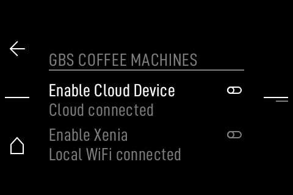

# Setup guide

## 1. Install

```sh
git clone https://github.com/MaxRink/e64ws-scale-bridge.git
cd e64ws-scale-bridge
python3 -m pip install -r requirements.txt
python3 -m unittest discover -s tests -v
```

`websocket-client` is required for the E64 WSS and OpenScale `ws://` paths.
`bleak` is optional and only needed for BLE.

## 2. Choose the scale

### Half Decent Scale / OpenScale over Wi-Fi

The scale serves an unauthenticated WebSocket at `ws://<host>/snapshot` with
untyped `{"grams": ..., "ms": ...}` snapshots.

```sh
python3 tools/scale_bridge.py --openscale hds.local --once --json
```

The scale should be on the same trusted LAN. No cloud account is used.

### Decent / Half Decent BLE

The notify characteristic is `0000FFF4-0000-1000-8000-00805F9B34FB` in service
`0000FFF0-...`. Weight frames are 7 or 10 bytes and start `03 CE`/`03 CA`
followed by a big-endian 16-bit value in 0.1 g.

```sh
python3 tools/scale_bridge.py --ble <address> --ble-kind decent --once
```

### Generic BLE Weight Scale

Service `0x181D`, characteristic `0x2A9D`. The parser handles the SI/imperial
flag and the standard `0.005 kg` / `0.01 lb` resolution.

```sh
python3 tools/scale_bridge.py --ble <address> --ble-kind generic --once
```

## 3. Connect the E64

The bridge needs a local WSS token. On a development-mode grinder:

```sh
python3 tools/scale_bridge.py --openscale hds.local \
  --grinder 192.168.1.50 --login-role Owner --insecure --apply --yes
```

If you have a token already, pass `--token` and `--wss-port 9997`. Do not put a
token in shell history. The event is printed before it is sent.



The grinder's Machine-to-Machine screen is where a local Xenia host is entered
for the stock path. The E64 WSS path above is separate and development-gated.

## 4. Shot detector

| Option | Default | Meaning |
|---|---:|---|
| `--baseline-samples` | 5 | samples used for the stable pre-shot baseline |
| `--start-threshold-g` | 0.5 | rise that starts a shot |
| `--stability-g` | 0.15 | allowed spread for the finish window |
| `--stable-ms` | 1000 | stable time before finishing |
| `--min-duration-ms` | 3000 | minimum detector window |
| `--valid-min-ms` | 15000 | Sync validity threshold |
| `--drop-threshold-g` | 2.0 | cup-removal drop |

The detector never guesses a stable baseline from a rising trend. It updates
the baseline only while the reading is within the stability tolerance.

## 5. Replay and troubleshooting

```sh
python3 tools/scale_bridge.py --replay examples/shot.jsonl --once --json
```

- No event printed: the sample rate is too low or the baseline never settled.
- Event is `validity: false`: the detected duration is under 15 s.
- `server closed the connection` on stock: expected; `AddBrewEvent` is dev-only.
- TLS error: the vendor certificate is self-signed; use `--insecure` only on a
  trusted local network, or provide `--ca-file`.
- BLE import error: install `bleak`; BLE is not needed for replay or Wi-Fi.

## 6. What is not automated

The bridge does not start or stop the grinder motor, change the burr setting,
calibrate the load cell, or write to the vendor cloud. On stock it produces a
measured shot; the operator enters the brew time or uses one of the stock
options in [STOCK_OPTIONS.md](STOCK_OPTIONS.md).
