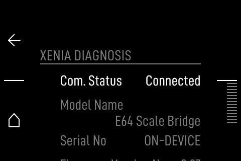
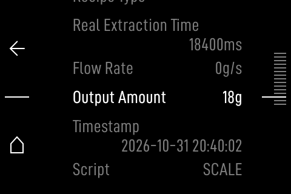

# On-device scale bridge (rooted E64 WS)

Status: **implemented and host/PHP-tested; not yet run on a physical E64.**
This is the WiFi/rooted path from
[`ON_DEVICE_SCALE_BRIDGE.md`](ON_DEVICE_SCALE_BRIDGE.md): a small daemon reads
an OpenScale/HDS `ws://<scale>/snapshot` stream, detects a shot, and writes an
atomic state file. PHP serves the five Xenia routes on the grinder's own port
80, so the E64 M2M client can point at `127.0.0.1` or the grinder's LAN address.
The vendor HMI is **not** patched; the stock M2M screen is the display.

This does **not** add BLE support to the E64. The E64 has no BLE central,
BlueZ, or BLE scale client. BLE scales still need an external sidecar.

## Architecture

```text
OpenScale/HDS --ws /snapshot--> scalebridged (www-data)
                                    |
                                    +--> /run/scale-bridge/state.json
                                    +--> /db/scale-bridge/shots.jsonl
E64 CmXeniaDriver --HTTP :80--> lighttpd/PHP
                                  /api/v2/mako          (HTTP exception)
                                  /api/v2/machine
                                  /api/v2/brewratio
                                  /api/v2/scripts/execute
                                    |
                              GbsService (stock)
```

The E64's own web UI gets `/scale/`, a read-only status page behind the vendor
session. No WSS, no dev mode and no REST login are required for this path.

## Requirements

- Rooted E64 (stock root is enough; dev mode is not required).
- Writable rootfs/app slot, or the vendor `unlockrfs`/`unlockapp` helpers.
  The installer needs both: the PHP page is in the app slot and the lighttpd
  exception plus init hook are on the rootfs.
- `/storage` and `/db` mounted (normal).
- A WiFi scale exposing `ws://<host>/snapshot` (OpenScale / Half Decent Scale).
- The grinder's Python 3.10 and lighttpd/PHP 8.4, both already present.

## Install

```sh
# 1. Preview
./ondevice/install.sh --dry-run

# 2. On the grinder, as root, after unlocking the app/rootfs slots
./ondevice/install.sh

# 3. Set the scale address
vi /db/scale-bridge/config.json
/etc/init.d/S95scalebridge restart

# 4. Open the vendor UI
#    http://<grinder>/scale/
```

Default config:

```json
{
  "host": "hds.local",
  "port": 80,
  "path": "/snapshot",
  "timeout": 10,
  "finishing_ms": 3000,
  "max_shot_ms": 120000,
  "ingest_token": "<random token for the ESP32 gateway>"
}
```

The installer creates `config.json` only when it is absent: it writes
`config.json.new` under `umask 077`, chmods that to `0640` and renames it, so a
crash leaves either the old file or the complete new one, and the ingest token
is never in a world-readable file even briefly. If an existing `config.json` is
not valid JSON (a truncated write from an older installer) it stops with an
error instead of printing "Keeping existing" over a file the daemon cannot
load.

`finishing_ms` is how long `/api/v2/mako` keeps returning
`MA_STATUS=4`/`REAL_EXTRACTION_TIME_MS` after a shot. Tune it to the E64 poll
interval if GBS misses the finishing state.

`max_shot_ms` bounds an active shot. A reading that never settles would
otherwise stay active forever and keep `MA_STATUS=3` (serving). At the bound the
shot is written as invalid with `reason: "timeout"`, so the status advances to
finishing and then idle.

Both keys are read from this file at start-up, and both have a flag that
overrides the file: `--finishing-ms` and `--max-shot-ms`. The rule is the same
for `timeout`/`--timeout`, `path`/`--path`, `host`/`--host`, `port`/`--port`
and `url`/`--url`: **the flag wins, the config value is the fallback**, and the
built-in default (`3000`, `120000`, `10`, `/snapshot`, `hds.local`, `80`)
applies only when neither is set. Tune them in `config.json` for a daemon
started by the init script, which passes no flags; pass the flag when running
`scalebridged.py` by hand.

Every one of them is checked by the same resolver, so a typo is one line on
stderr and a non-zero exit, not a traceback with the daemon never started:
`"port": "eighty"` gives `config port must be a number, not 'eighty'`, a port
outside 1..65535 (including an explicit `--port 0`) is refused instead of
silently replaced by the config value, and a non-string `host`/`url`/`path` is
refused the same way. An invalid `max_shot_ms`/`finishing_ms`/`timeout` was
already handled like that.

A `url` is validated as well, by the same function the WebSocket client uses:
the scheme must be `ws://` (host non-empty, port in 1..65535, a missing port
means 80), and `wss://` is refused with the reason -- this client has no TLS
and the scale's snapshot endpoint is a plain `ws://` LAN peer. So
`--url ftp://hds.local/snapshot`, `--url ws://hds.local:0/snapshot`,
`--url ws://hds.local:70000/snapshot` and `--url ws://:80/snapshot` are each
one line on stderr and exit 1, instead of a daemon that retried the refusal
with backoff and exited 0 after writing only `connection error` lines.

## What gets installed

| Path | Purpose | Survives signed update? |
|---|---|---|
| `/storage/scale-bridge/` | daemon + copied detector/parser modules | Usually (A/B); `upload_swu.php?prepare` wipes `/storage` |
| `/db/scale-bridge/config.json` | scale address and tuning | Yes |
| `/db/scale-bridge/shots.jsonl` | one JSON line per completed shot; rotated to `shots.jsonl.1` at 4 MiB, so at most ~8 MiB is kept | Yes |
| `/db/scale-bridge/lighttpd.conf.vendor*` | restore point + the newest 5 pre-edit snapshots, ordered by when they were written; older ones are pruned | Yes |
| `/run/scale-bridge/state.json` | live state for PHP/WebUI | No (tmpfs) |
| `/log/scalebridged.log` | daemon stdout/stderr; rotated to `.1` at 1 MiB when the init script starts it | No (rootfs) |
| `/usr/local/www/api/v2/` | Xenia routes | No; re-run installer |
| `/usr/local/www/scale/` | WebUI status page | No; re-run installer |
| `/etc/init.d/S95scalebridge` | start/stop hook | No; re-run installer |
| `/etc/lighttpd/lighttpd.conf` | narrow `/api/v2/` HTTP exception | No; vendor snapshot in `/db/scale-bridge/lighttpd.conf.vendor*` |

The installer refuses to overwrite an existing `/usr/local/www/api/v2` or init
script unless it owns it (marker) or `--force` is used. It never remounts,
patches the HMI, or touches the ESP32.

Nothing on the device grows without a bound: the shot history, the daemon log
and the pre-edit lighttpd snapshots are all capped (see the table). The caps
are `SHOTS_MAX_BYTES`/`SHOTS_KEEP` in `ondevice/scalebridged.py`,
`SNAPSHOT_KEEP` in `ondevice/patch_lighttpd.py`, and
`SCALE_BRIDGE_LOG_MAX_BYTES` (default 1 MiB, one rotated file) in
`ondevice/S95scalebridge`.

### Why lighttpd is patched

The E64 Xenia client is **HTTP-only**: `RestClient::open(host, 80)` builds
`http://<host>/api/v2/...` and does not use TLS. The vendor lighttpd config
redirects every HTTP request to HTTPS, so an unpatched grinder would return
`301` and the client would never reach PHP. The installer adds one marked
block that:

- exempts only `^/api/v2/` from the HTTP->HTTPS redirect;
- rewrites the five exact Xenia paths (`mako`, `machine`, `brewratio`,
  `scripts/execute`, `ingest`) to their `index.php` so no directory redirect is
  needed;
- leaves every other HTTP path redirected to HTTPS.

**Cleartext trade-off.** The exemption is plain HTTP by design, so every request
under `/api/v2/` is readable and injectable on the LAN path: the
`POST /api/v2/brewratio` write carries the `SYNC_BEVERAGE_WEIGHT`/`SYNC_FILTER`
pair, and `/api/v2/ingest` carries its `X-Scale-Token` header in the clear. This
is accepted only for a trusted, isolated LAN on a unit that is not reachable
from the internet; the E64 client cannot use TLS, so restricting the exemption
would break the M2M path. Same text in the comment of the installed block
(`ondevice/patch_lighttpd.py`).

Every edit snapshots the pre-edit file under a unique name
(`/db/scale-bridge/lighttpd.conf.vendor.<UTC timestamp>.<n>`) before it writes,
and keeps the newest five of them by write time. The `<n>` counter is only the
tiebreak for a filesystem whose clock is coarser than the edit rate, and it is
compared as a number, so `.10` is newer than `.9`.
`/db/scale-bridge/lighttpd.conf.vendor` is the restore point and holds the
exact bytes of the unpatched vendor config that the current block was applied
to, so a firmware update that ships a new vendor config refreshes it on the
next install instead of restoring a stale file. `--restore` (and
`uninstall.sh`) copies that snapshot back byte-for-byte. `lighttpd -t` is run
before the restart and the snapshot is restored if it fails. Use
`--no-lighttpd` only if you serve Xenia from a different host/port.

Every copy in this path -- the snapshot, the restore point and the live config
-- is written to a `.tmp` file, fsynced and renamed, so a power loss during a
write leaves the previous file intact rather than a half file that looks
complete. `--restore` also validates the snapshot before it copies anything:
the file must be non-empty, brace-balanced and hold at least one lighttpd
directive. A backup that fails that check (a truncated restore point from an
interrupted snapshot, a garbage file) is refused loudly -- exit code 5, the
live config untouched, and the newest complete `lighttpd.conf.vendor.*`
snapshot named -- newest meaning most recently written, which is the one that
matches the config the unit is running -- so you can re-run
`--backup <that file>`.

## Endpoints

| Method | Path | Behavior |
|---|---|---|
| GET | `/api/v2/mako` | Xenia Mako shape; idle/serving/finishing from state, gated on the state file being fresh (10 s) |
| GET | `/api/v2/machine` | Xenia machine identity |
| POST | `/api/v2/brewratio` | validate + persist `SYNC_BEVERAGE_WEIGHT`/`SYNC_FILTER`, echo pair |
| POST | `/api/v2/scripts/execute` | record brew start, echo `{"ok":true,"ID":...}` |
| POST | `/api/v2/ingest` | ESP32 gateway snapshot; requires the `X-Scale-Token` header |

The first two are unauthenticated by design because the E64 M2M client does not
log in. They expose only shot state, not grinder actions. Do not expose port 80
to the internet.

## State schema

```json
{
  "schema": 1,
  "source": "ws://hds.local:80/snapshot",
  "connected": true,
  "phase": "idle|serving|finishing",
  "ma_status": 1,
  "extraction_status": 0,
  "live_grams": 17.4,
  "live_ms": 12345,
  "last_shot": {
    "duration_ms": 24600,
    "mass_g": 18.0,
    "valid": true,
    "reason": "stable",
    "at_ms": 1760000000000
  },
  "finishing_until_ms": 0,
  "shot_count": 1,
  "reconnects": 1,
  "error": "",
  "updated_ms": 1760000000000
}
```

The daemon writes atomically (`state.json.tmp` + rename) and throttles live
updates to 10 Hz. Shot history is append-only JSONL.

## HMI integration

There are two different UIs on the E64:

| UI | What it is | What this project does |
|---|---|---|
| Graphical HMI | Qt/QML `NgxUiApp` + `libNgxUi.so`, 320×480, rotary/6 keys, no touch | **Not patched.** Uses the vendor M2M/coffee-machine screen. |
| Web UI | lighttpd/PHP at `https://<grinder>/` | Adds `/scale/` (read-only live weight/last shot) and the five Xenia routes (the Xenia routes are also reachable over the cleartext HTTP exception). |

### Current, low-risk integration: vendor M2M screen

The vendor HMI already has an M2M/coffee-machine configuration screen. Point it
at the grinder's own address (`127.0.0.1` or its LAN IP), select the Xenia
machine, and enable M2M. The HMI is designed to use the PHP-served
`/api/v2/machine` and `/api/v2/mako` documents exactly as it would use a real
Xenia. The existing **Xenia Diagnosis** screen then shows:

| HMI label | Source |
|---|---|
| Com. Status / Machine Status | `MA_STATUS` / connection |
| Output Amount (g) | `PU_SENS_FLOW_METER_VOLUME` = live grams (or last shot mass while finishing) |
| Flow Rate (g/s) | `PU_SENS_FLOW_METER_FLOWRATE` |
| Real Extraction Time (ms) | `REAL_EXTRACTION_TIME_MS` = live active time, then final shot time |
| Script | `script` = `SCALE` (identifies the local bridge) |
| Temperatures / Tank / Timestamp | static or local timestamp |

Navigation: **Machine To Machine → Enable XENIA → Diagnosis**; **Configuration
→ Edit Host** to set `127.0.0.1` or the grinder's LAN IP. No QML patch is
needed for this view.

Rendered from the vendor QML with the bridge values:




These renders use the extracted vendor QML with the bridge values; the live
QEMU HMI was blocked by its expected "Security data missing" modal, so the
end-to-end panel interaction is not yet observed.

This gives a two-device setup with no HMI modification:

```text
scale --WiFi--> scalebridged --state--> PHP Xenia <--HTTP-- vendor HMI/GBS
```

This gives a live weight/flow/time/status view on the built-in HMI through the
vendor's own Xenia screen. It does not add tare/start/stop buttons or a BLE
gateway configuration screen; those stay on the scale/WebUI until a custom HMI
is accepted. Whether the HMI/GBS actually applies the Xenia extraction time to
the dial is still the physical A/B gate.

### ESP32 BLE gateway ingest

A future ESP32 BLE-central firmware can feed the same state without touching
the STM32:

```text
BLE scale -> ESP32 (central + shot detector) --HTTP POST--> /api/v2/ingest
                                                         -> esp-state.json
                                                         -> /api/v2/mako -> HMI/GBS
```

The endpoint is token-protected with `ingest_token` from the config. A fresh ESP
snapshot wins for 5 s, then the WiFi daemon resumes. Contract, firmware plan and
resource caveats: `docs/ESP32_BLE_GATEWAY.md`.

### Why the HMI is not patched

All 167 QML/JS files are compiled into `libNgxUi.so` qrc resources. Verified
negatives: `QML2_IMPORT_PATH` does not override them, an external
`/usr/local/qml/Qml/NgxUi/MainItem.qml` is ignored, and
`QT_ADDITIONAL_RESOURCE` does not exist in Qt 5.15.8. There is no filesystem
extension point or plugin loader for an extra HMI screen.

The available custom-HMI routes are ranked in
`docs/UI_CUSTOMISATION.md` (research repo):

| Option | Effort | Survives update | Risk |
|---|---|---|---|
| Stock M2M screen + `/scale/` WebUI | done | WebUI no | none |
| Drop-in `qmlscene` HMI | 1–3 h | no | medium; loses vendor screens, update UI and hardware input |
| Framebuffer overlay | ~1 day | no | medium; HMI repaints erase it, needs compositing |
| Patch/replace `libNgxUi.so` qrc | 1–2 days | no | high; preserves vendor UI but needs qrc rebuild and recovery |
| `LD_PRELOAD` QResource shim | 2–3 days | no | medium-high; untested |
| Custom signed SWU | vendor key | yes | brick risk; not available |

The recommended path is the stock M2M screen for control/status and the
`/scale/` page for live weight. A native HMI widget should be a separate,
explicitly accepted high-risk project, tested first on QEMU with a recovery
image.

## Security

- The daemon starts as root, reads the config, then drops to `www-data` before
  opening the scale connection or writing state.
- `/run/scale-bridge` and `/db/scale-bridge` are owned by `www-data`.
- The WebUI page uses the vendor `sessionManager.php`; it is not a new auth
  system. It is read-only.
- The Xenia endpoints are local-only by intent **and unencrypted**: `/api/v2/*`
  is exempt from the HTTPS redirect, so brewratio writes and the ESP32
  `X-Scale-Token` header travel in cleartext. If the grinder is on an untrusted
  LAN, restrict port 80 or put the unit behind a trusted network.
- No cloud calls, tokens, vendor keys or official-scale identity are used.

## Verification

Off-device:

```sh
# daemon + bridge + uninstall tests (174 tests; the 15 PHP-endpoint tests skip
# as a group when php is not on PATH, and the shell tests skip without Docker)
python3 -m unittest discover -s tests -v

# PHP 8.4 endpoints/page/ESP32 ingest, in Docker
./tools/run_php_tests.sh

# ondevice/uninstall.sh, against a throwaway root filesystem in Docker
python3 -m unittest tests.test_ondevice_shell -v
```

The daemon test uses a fake RFC 6455 scale and a real shot sequence: five idle
samples, a rise, a stable 18 g window. It asserts state, phase, finishing,
history and non-monotonic clock handling. The PHP tests cover all five routes,
validation, finishing expiry and the WebUI page. Separate tests cover the
lighttpd snapshot/patch/restore round-trip, the WSS client's timeout and
redaction paths, and a PHP-source check for the E64's missing `filter`
extension.

QEMU evidence (from-SWU image, 2026-10-31): after `install.sh`, HTTP
`GET /api/v2/mako` returned `200` with a real shot state
(`MA_STATUS=4`, `REAL_EXTRACTION_TIME_MS=3200`), `POST /api/v2/brewratio`
returned the echoed pair, and `/scale/` still redirected to HTTPS. A second
install/uninstall cycle with the installed `uninstall.sh --yes --purge`
restored the vendor `lighttpd.conf`, removed the init hook and removed
`/db/scale-bridge`. The E64 HMI was blocked by its expected "Security data
missing" modal, so an end-to-end client poll/GBS A/B was **not** observed yet.

On a QEMU/virtual E64 (next):

1. Run `install.sh --dry-run` and then install on a disposable snapshot.
2. Verify the page loads after vendor login and `/scale/` does not create a
   token storm.
3. Run a local fake scale on the VM host; point `config.json` at it.
4. Poll `/api/v2/mako` from the VM and verify idle → serving → finishing → idle.
5. Confirm vendor pages, HMI, WSS and update UI still work.
6. Reboot; confirm the init hook and state recovery.

Physical (requires owner authorization):

1. Install on a rooted unit; verify only 8 WSS commands remain (root alone does
   not unlock dev actions).
2. Point the E64 M2M host at the grinder's own address.
3. Pull a real shot; verify `REAL_EXTRACTION_TIME_MS` and whether GBS moves the
   dial. This is the make-or-break claim.
4. Repeat at 15 s and 45 s, ≥3 reps, with a no-injection control.
5. Check `/db` survival, signed-update loss/reapply, and uninstall. When you
   record evidence, **redact before it leaves the device**: the `ingest_token`
   value in `/db/scale-bridge/config.json`, any `X-Scale-Token`/`Authorization`
   header, and the `?token=` query value of a WSS URL. Keep the config file at
   mode `0640`; paste only placeholders (`<redacted>`) into a ticket or chat.
   The WSS client already redacts its own error lines
   (`e64ws_client.redact`); shell history and `curl -v` output are not covered.

## Limitations

- **GBS consumption is unproven.** The E64 polls the Xenia shape over HTTP,
  but whether GBS applies the extraction time to the dial needs a physical A/B.
- **No end-to-end client poll observed in QEMU.** The VM's HMI was blocked by
  the expected "Security data missing" modal; the HTTP routes and installer
  were verified independently.
- **HMI untouched.** There is no touch controller and no vendor extension
  point; patching `libNgxUi.so` is high-risk and lost on update. Use the stock
  M2M screen.
- **BLE not supported on-device.** Use an external sidecar or a WiFi scale.
- **Dev mode not required, but not a substitute for it.** `AddBrewEvent` and
  the 44 dev WSS actions remain unavailable; this path uses Xenia only.
- **No stock no-root install.** Writing `/usr/local/www` and `/etc/init.d`
  requires root.

Open review items (token refresh, TLS pinning, WSS reconnect, tare, the dropout
event path) are listed with their status in
[REVIEW_FOLLOWUPS.md](REVIEW_FOLLOWUPS.md).

## Recovery

```sh
# Stop and remove the service/page; keep /db config and shots
./ondevice/uninstall.sh --yes

# Also remove /db/scale-bridge
./ondevice/uninstall.sh --yes --purge
```

If the daemon misbehaves, `S95scalebridge stop` is enough; the rest of the
grinder is unaffected. The vendor HMI/update path is not modified.
