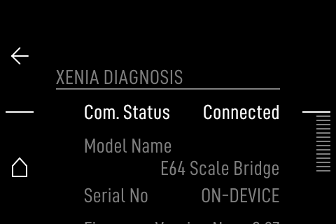
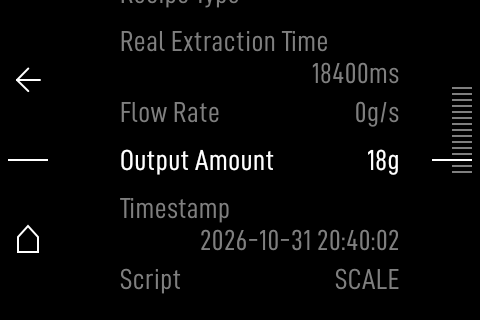

# On-device scale bridge (rooted E64 WS)

Status: **implemented and host/PHP-tested; not yet run on a physical E64.**
This is the WiFi/rooted path from
[`ON_DEVICE_SCALE_BRIDGE.md`](ON_DEVICE_SCALE_BRIDGE.md): a small daemon reads
an OpenScale/HDS `ws://<scale>/snapshot` stream, detects a shot, and writes an
atomic state file. PHP serves the four Xenia routes on the grinder's own port
80, so the E64 M2M client can point at `127.0.0.1` or the grinder's LAN address.
The vendor HMI is **not** patched; the stock M2M screen is the display.

This does **not** add BLE support to the E64. The E64 has no BLE central,
BlueZ, or BLE scale client. BLE scales still need an external sidecar.

## Architecture

```text
OpenScale/HDS --ws /snapshot--> scalebridged (www-data)
                                    |
                                    +--> /run/scale-bridge/state.json
                                    +--> /db/scale-bridge/shots.jsonl
E64 CmXeniaDriver --HTTP :80--> lighttpd/PHP
                                  /api/v2/mako          (HTTP exception)
                                  /api/v2/machine
                                  /api/v2/brewratio
                                  /api/v2/scripts/execute
                                    |
                              GbsService (stock)
```

The E64's own web UI gets `/scale/`, a read-only status page behind the vendor
session. No WSS, no dev mode and no REST login are required for this path.

## Requirements

- Rooted E64 (stock root is enough; dev mode is not required).
- Writable rootfs/app slot, or the vendor `unlockrfs`/`unlockapp` helpers.
  The installer needs both: the PHP page is in the app slot and the lighttpd
  exception plus init hook are on the rootfs.
- `/storage` and `/db` mounted (normal).
- A WiFi scale exposing `ws://<host>/snapshot` (OpenScale / Half Decent Scale).
- The grinder's Python 3.10 and lighttpd/PHP 8.4, both already present.

## Install

```sh
# 1. Preview
./ondevice/install.sh --dry-run

# 2. On the grinder, as root, after unlocking the app/rootfs slots
./ondevice/install.sh

# 3. Set the scale address
vi /db/scale-bridge/config.json
/etc/init.d/S95scalebridge restart

# 4. Open the vendor UI
#    http://<grinder>/scale/
```

Default config:

```json
{
  "host": "hds.local",
  "port": 80,
  "path": "/snapshot",
  "timeout": 10,
  "finishing_ms": 3000,
  "ingest_token": "<random token for the ESP32 gateway>"
}
```

`finishing_ms` is how long `/api/v2/mako` keeps returning
`MA_STATUS=4`/`REAL_EXTRACTION_TIME_MS` after a shot. Tune it to the E64 poll
interval if GBS misses the finishing state.

## What gets installed

| Path | Purpose | Survives signed update? |
|---|---|---|
| `/storage/scale-bridge/` | daemon + copied detector/parser modules | Usually (A/B); `upload_swu.php?prepare` wipes `/storage` |
| `/db/scale-bridge/config.json` | scale address and tuning | Yes |
| `/db/scale-bridge/shots.jsonl` | one JSON line per completed shot | Yes |
| `/run/scale-bridge/state.json` | live state for PHP/WebUI | No (tmpfs) |
| `/usr/local/www/api/v2/` | Xenia routes | No; re-run installer |
| `/usr/local/www/scale/` | WebUI status page | No; re-run installer |
| `/etc/init.d/S95scalebridge` | start/stop hook | No; re-run installer |
| `/etc/lighttpd/lighttpd.conf` | narrow `/api/v2/` HTTP exception | No; backup in `/db/scale-bridge/lighttpd.conf.vendor` |

The installer refuses to overwrite an existing `/usr/local/www/api/v2` or init
script unless it owns it (marker) or `--force` is used. It never remounts,
patches the HMI, or touches the ESP32.

### Why lighttpd is patched

The E64 Xenia client is **HTTP-only**: `RestClient::open(host, 80)` builds
`http://<host>/api/v2/...` and does not use TLS. The vendor lighttpd config
redirects every HTTP request to HTTPS, so an unpatched grinder would return
`301` and the client would never reach PHP. The installer adds one marked
block that:

- exempts only `^/api/v2/` from the HTTP->HTTPS redirect;
- rewrites the four exact Xenia paths to their `index.php` so no directory
  redirect is needed;
- leaves every other HTTP path redirected to HTTPS.

The vendor config is backed up first; `lighttpd -t` is run before restart, and
the backup is restored on failure or on `uninstall.sh`. Use `--no-lighttpd`
only if you serve Xenia from a different host/port.

## Endpoints

| Method | Path | Behavior |
|---|---|---|
| GET | `/api/v2/mako` | Xenia Mako shape; idle/serving/finishing from state |
| GET | `/api/v2/machine` | Xenia machine identity |
| POST | `/api/v2/brewratio` | validate + persist `SYNC_BEVERAGE_WEIGHT`/`SYNC_FILTER`, echo pair |
| POST | `/api/v2/scripts/execute` | record brew start, echo `{"ok":true,"ID":...}` |

The first two are unauthenticated by design because the E64 M2M client does not
log in. They expose only shot state, not grinder actions. Do not expose port 80
to the internet.

## State schema

```json
{
  "schema": 1,
  "source": "ws://hds.local:80/snapshot",
  "connected": true,
  "phase": "idle|serving|finishing",
  "ma_status": 1,
  "extraction_status": 0,
  "live_grams": 17.4,
  "live_ms": 12345,
  "last_shot": {
    "duration_ms": 24600,
    "mass_g": 18.0,
    "valid": true,
    "reason": "stable",
    "at_ms": 1760000000000
  },
  "finishing_until_ms": 0,
  "shot_count": 1,
  "reconnects": 1,
  "error": "",
  "updated_ms": 1760000000000
}
```

The daemon writes atomically (`state.json.tmp` + rename) and throttles live
updates to 10 Hz. Shot history is append-only JSONL.

## HMI integration

There are two different UIs on the E64:

| UI | What it is | What this project does |
|---|---|---|
| Graphical HMI | Qt/QML `NgxUiApp` + `libNgxUi.so`, 320×480, rotary/6 keys, no touch | **Not patched.** Uses the vendor M2M/coffee-machine screen. |
| Web UI | lighttpd/PHP at `https://<grinder>/` | Adds `/scale/` (read-only live weight/last shot) and the four Xenia routes. |

### Current, low-risk integration: vendor M2M screen

The vendor HMI already has an M2M/coffee-machine configuration screen. Point it
at the grinder's own address (`127.0.0.1` or its LAN IP), select the Xenia
machine, and enable M2M. The HMI is designed to use the PHP-served
`/api/v2/machine` and `/api/v2/mako` documents exactly as it would use a real
Xenia. The existing **Xenia Diagnosis** screen then shows:

| HMI label | Source |
|---|---|
| Com. Status / Machine Status | `MA_STATUS` / connection |
| Output Amount (g) | `PU_SENS_FLOW_METER_VOLUME` = live grams (or last shot mass while finishing) |
| Flow Rate (g/s) | `PU_SENS_FLOW_METER_FLOWRATE` |
| Real Extraction Time (ms) | `REAL_EXTRACTION_TIME_MS` = live active time, then final shot time |
| Script | `script` = `SCALE` (identifies the local bridge) |
| Temperatures / Tank / Timestamp | static or local timestamp |

Navigation: **Machine To Machine → Enable XENIA → Diagnosis**; **Configuration
→ Edit Host** to set `127.0.0.1` or the grinder's LAN IP. No QML patch is
needed for this view.

Rendered from the vendor QML with the bridge values:




These renders use the extracted vendor QML with the bridge values; the live
QEMU HMI was blocked by its expected "Security data missing" modal, so the
end-to-end panel interaction is not yet observed.

This gives a two-device setup with no HMI modification:

```text
scale --WiFi--> scalebridged --state--> PHP Xenia <--HTTP-- vendor HMI/GBS
```

This gives a live weight/flow/time/status view on the built-in HMI through the
vendor's own Xenia screen. It does not add tare/start/stop buttons or a BLE
gateway configuration screen; those stay on the scale/WebUI until a custom HMI
is accepted. Whether the HMI/GBS actually applies the Xenia extraction time to
the dial is still the physical A/B gate.

### ESP32 BLE gateway ingest

A future ESP32 BLE-central firmware can feed the same state without touching
the STM32:

```text
BLE scale -> ESP32 (central + shot detector) --HTTP POST--> /api/v2/ingest
                                                         -> esp-state.json
                                                         -> /api/v2/mako -> HMI/GBS
```

The endpoint is token-protected with `ingest_token` from the config. A fresh ESP
snapshot wins for 5 s, then the WiFi daemon resumes. Contract, firmware plan and
resource caveats: `docs/ESP32_BLE_GATEWAY.md`.

### Why the HMI is not patched

All 167 QML/JS files are compiled into `libNgxUi.so` qrc resources. Verified
negatives: `QML2_IMPORT_PATH` does not override them, an external
`/usr/local/qml/Qml/NgxUi/MainItem.qml` is ignored, and
`QT_ADDITIONAL_RESOURCE` does not exist in Qt 5.15.8. There is no filesystem
extension point or plugin loader for an extra HMI screen.

The available custom-HMI routes are ranked in
`docs/UI_CUSTOMISATION.md` (research repo):

| Option | Effort | Survives update | Risk |
|---|---|---|---|
| Stock M2M screen + `/scale/` WebUI | done | WebUI no | none |
| Drop-in `qmlscene` HMI | 1–3 h | no | medium; loses vendor screens, update UI and hardware input |
| Framebuffer overlay | ~1 day | no | medium; HMI repaints erase it, needs compositing |
| Patch/replace `libNgxUi.so` qrc | 1–2 days | no | high; preserves vendor UI but needs qrc rebuild and recovery |
| `LD_PRELOAD` QResource shim | 2–3 days | no | medium-high; untested |
| Custom signed SWU | vendor key | yes | brick risk; not available |

The recommended path is the stock M2M screen for control/status and the
`/scale/` page for live weight. A native HMI widget should be a separate,
explicitly accepted high-risk project, tested first on QEMU with a recovery
image.

## Security

- The daemon starts as root, reads the config, then drops to `www-data` before
  opening the scale connection or writing state.
- `/run/scale-bridge` and `/db/scale-bridge` are owned by `www-data`.
- The WebUI page uses the vendor `sessionManager.php`; it is not a new auth
  system. It is read-only.
- The Xenia endpoints are local-only by intent. If the grinder is on an
  untrusted LAN, restrict port 80 or put the unit behind a trusted network.
- No cloud calls, tokens, vendor keys or official-scale identity are used.

## Verification

Off-device:

```sh
# daemon + existing bridge tests (52 tests, 1 skip when PHP is absent)
python3 -m unittest discover -s tests -v

# PHP 8.4 endpoints/page/ESP32 ingest, in Docker
./tools/run_php_tests.sh
```

The daemon test uses a fake RFC 6455 scale and a real shot sequence: five idle
samples, a rise, a stable 18 g window. It asserts state, phase, finishing,
history and non-monotonic clock handling. The PHP tests cover all four routes,
validation, finishing expiry and the WebUI page. A separate test covers the
lighttpd patch/restore and a PHP-source check for the E64's missing `filter`
extension.

QEMU evidence (from-SWU image, 2026-10-31): after `install.sh`, HTTP
`GET /api/v2/mako` returned `200` with a real shot state
(`MA_STATUS=4`, `REAL_EXTRACTION_TIME_MS=3200`), `POST /api/v2/brewratio`
returned the echoed pair, and `/scale/` still redirected to HTTPS. A second
install/uninstall cycle with the installed `uninstall.sh --yes --purge`
restored the vendor `lighttpd.conf`, removed the init hook and removed
`/db/scale-bridge`. The E64 HMI was blocked by its expected "Security data
missing" modal, so an end-to-end client poll/GBS A/B was **not** observed yet.

On a QEMU/virtual E64 (next):

1. Run `install.sh --dry-run` and then install on a disposable snapshot.
2. Verify the page loads after vendor login and `/scale/` does not create a
   token storm.
3. Run a local fake scale on the VM host; point `config.json` at it.
4. Poll `/api/v2/mako` from the VM and verify idle → serving → finishing → idle.
5. Confirm vendor pages, HMI, WSS and update UI still work.
6. Reboot; confirm the init hook and state recovery.

Physical (requires owner authorization):

1. Install on a rooted unit; verify only 8 WSS commands remain (root alone does
   not unlock dev actions).
2. Point the E64 M2M host at the grinder's own address.
3. Pull a real shot; verify `REAL_EXTRACTION_TIME_MS` and whether GBS moves the
   dial. This is the make-or-break claim.
4. Repeat at 15 s and 45 s, ≥3 reps, with a no-injection control.
5. Check `/db` survival, signed-update loss/reapply, and uninstall.

## Limitations

- **GBS consumption is unproven.** The E64 polls the Xenia shape over HTTP,
  but whether GBS applies the extraction time to the dial needs a physical A/B.
- **No end-to-end client poll observed in QEMU.** The VM's HMI was blocked by
  the expected "Security data missing" modal; the HTTP routes and installer
  were verified independently.
- **HMI untouched.** There is no touch controller and no vendor extension
  point; patching `libNgxUi.so` is high-risk and lost on update. Use the stock
  M2M screen.
- **BLE not supported on-device.** Use an external sidecar or a WiFi scale.
- **Dev mode not required, but not a substitute for it.** `AddBrewEvent` and
  the 44 dev WSS actions remain unavailable; this path uses Xenia only.
- **No stock no-root install.** Writing `/usr/local/www` and `/etc/init.d`
  requires root.

## Recovery

```sh
# Stop and remove the service/page; keep /db config and shots
./ondevice/uninstall.sh --yes

# Also remove /db/scale-bridge
./ondevice/uninstall.sh --yes --purge
```

If the daemon misbehaves, `S95scalebridge stop` is enough; the rest of the
grinder is unaffected. The vendor HMI/update path is not modified.
