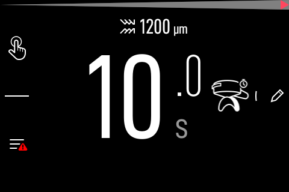

# Stock-firmware options

The E64 exposes eight always-on WSS commands. Grind, GBS and `AddBrewEvent` are
development-only. That gate is not bypassed by a valid Owner token.

## A. Manual brew time — works today

The grinder has an on-screen brew-time field. A custom scale measures the shot,
and the operator enters the measured duration. The grinder's own GBS logic
chooses the adjustment. No root, no cloud, no modified app.



## B. Local Xenia emulator — stock, automatic, unproven GBS effect

`tools/xenia_emulator.py` implements the four routes the grinder polls:

- `GET /api/v2/mako`
- `GET /api/v2/machine`
- `POST /api/v2/brewratio`
- `POST /api/v2/scripts/execute`

Start it and enter the host in the grinder's Machine-to-Machine screen. Feed a
finished shot with `POST /control/shot` and see whether the next grind's dial
moves. The protocol is recovered; the GBS consequence needs a physical test.

```sh
python3 tools/xenia_emulator.py --port 8080 --control-port 8081
curl -s -X POST http://127.0.0.1:8081/control/shot \
  -H 'content-type: application/json' \
  -d '{"duration_ms":25000,"mass_g":18.2}'
```

## C. Owner-account cloud event

The grinder polls the vendor cloud for brew events. Posting an event under the
owner's own account is the legitimate cloud path. It needs a consented capture
of the app's auth and brew-event request shape; it is not implemented here.

Do **not** clone an official scale's serial, certificate or provisioning blob.
The official scale is Wi-Fi/cloud and serial-bound; there is no BLE
advertisement to impersonate.

## D. Modified official app

The official app is Flutter AOT and has no Bluetooth permission. A re-signed
patch is possible in principle but is release-specific and still needs cloud
identity. A clean-room app is the maintainable alternative.

## E. Root / development unlock

With the 14-token `/etc/issue` development profile or root, all 52 WSS records
including `AddBrewEvent` and `StartGrindGbw` are available. That is the path
this bridge uses for direct events, but it is not stock.
